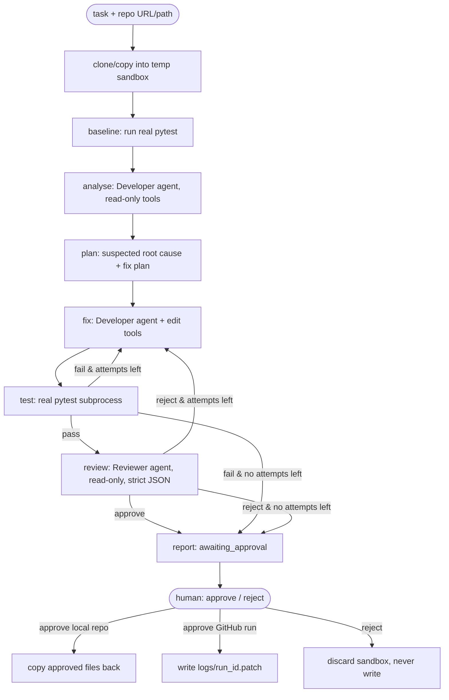
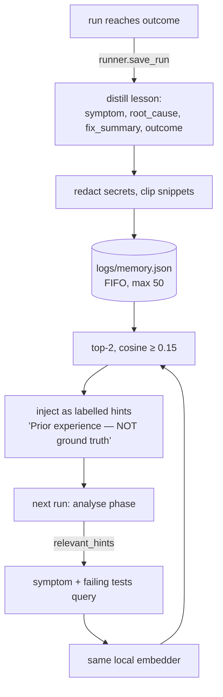

# Fixora — Architecture

Fixora is a LangGraph agent that repairs Python repositories under a hard
human-approval gate. This document maps the moving parts; `SPEC.md` records the
phase-by-phase history and the honest "not verified" lists.

## Agent loop



Retry semantics: reviewer rejection re-enters `fix` with the reviewer's issues;
a failing test re-enters `fix` with the failing output. Both count toward
`MAX_ATTEMPTS` (default 3). A passing suite is **not** enough — the run stops at
`awaiting_approval` and nothing touches the original repo until a human acts.

## Hybrid retrieval pipeline

```mermaid
flowchart LR
    REPO[(copied repo)] --> IDX{index signature<br/>relpath+mtime+size}
    IDX -->|changed| CHUNK[AST chunking:<br/>function/class/method/test<br/>+ module chunk<br/>+ line-window fallback]
    CHUNK --> BM25[BM25Okapi<br/>rank_bm25, internal fallback]
    CHUNK --> VEC[local hash embedder<br/>384-dim bag-of-n-grams<br/>or fastembed BAAI/bge-small-en-v1.5]
    Q[failure-driven queries<br/>failing tests + diagnosis + exception] --> BM25
    Q --> VEC
    BM25 --> RRF[Reciprocal Rank Fusion<br/>k=60]
    VEC --> RRF
    RRF --> ASSIST{FIXORA_RERANK=1?<br/>Groq reranker}
    ASSIST -->|LLM error/invalid JSON/timeout| LOCAL[keep local order]
    ASSIST -->|ok| REORDER[reordered top-k]
    RRF -->|FIXORA_QUERY_REWRITE=1| RW[Groq query expansion,<br/>cached, also skippable]
    RW --> BM25
    RW --> VEC
    REORDER --> PROMPT[inject into analyse/plan/fix prompt]
    LOCAL --> PROMPT
    PROMPT --> LOG[(retrieval event → run log,<br/>UI panel, stats())]
```

Query rewriting happens *before* retrieval (the expanded queries feed both
scorers); reranking happens *after* fusion; both are default-on but never
required — local ranking is the correct degradation path, not an error path.

Index properties: signature-cached, rebuilt on any repo change; skips `.git`,
venvs, caches; above a size threshold only code+tests are indexed; chunk cap is
enforced (`_MAX_CHUNKS`); index cost is reported in `stats()`
(`build_ms`, `file_bytes`) and the `retrieval` event.

## Cross-run memory



`FIXORA_MEMORY=0` disables load+save. `GET /memory` exposes the store. Memory
is best-effort everywhere: failures log and return empty — they never crash or
block a run, and hints never bypass the approval gate.

## Sandbox & trust boundaries

- Repo is **copied** to a temp dir; all reads/edits/tests happen there.
- LLM-supplied paths resolve inside the sandbox (`..`, absolute paths, symlink
  escapes rejected).
- Commands allowlisted (`python -m pytest|py_compile|unittest`), no shell,
  timeout, truncated output, minimal allowlisted env (host API keys not visible
  to repo code).
- Dependencies installed only from the repo's own declared files
  (`requirements.txt` / validated `pyproject.toml [project]` specifiers — no
  model-named packages, no URLs/markers), into an isolated `--target` temp dir
  with a wall-clock timeout and a size cap (`FIXORA_INSTALL_MAX_MB`, default
  512 MB); never the host interpreter; deleted with the run.
- `.env` and credential files are gitignored, never copied into the sandbox,
  and rejected by the read/write tools.
- Keys are never printed (startup prints provider labels only), redacted from
  events/logs, and run logs/patches are `0600`.

## Approval gate

Passing tests + reviewer approval ⇒ `awaiting_approval`. `--yes` (CLI) or
`POST /runs/{id}/approve` (API) applies the reviewed diff — local repos only;
GitHub clones and demo fixtures export a `logs/<id>.patch` instead. `--reject`
marks the run `rejected` and writes nothing. Non-`awaiting_approval` runs return
409 on approve/reject. Demo fixtures can never be mutated through the UI —
approval exports a patch.

## Observability

Every step is a typed event in an append-only history (`logs/<ts>-<id>.json`):
`step`, `tool_call`, `tool_result`, `test_result`, `diagnosis`, `retrieval`,
`memory`, `review_verdict`, `retry`, `awaiting_approval`, `done`. SSE replays
history with `id:` sequence + `Last-Event-ID`; the UI dedupes by `seq`. Token
usage reported by providers is logged as `[LLM USAGE]`; identical tool calls in
one run are cached (`[CACHED]`); timings are aggregated into the report.

## Deliberate deviations (documented)

| Decision | Rationale |
|---|---|
| No FAISS — pure-Python cosine scan | <5k chunks; avoids a native dep; interface kept for swap |
| Hashed hash embedder default | zero downloads, deterministic, works offline; fastembed opt-in |
| In-memory vector store (per run) | indexes are small and rebuilt fast; no DB infrastructure needed |
| JSON flat-file memory | hackathon scope; FIFO cap + similarity recall is adequate |
| No DB/queue for run state | one run at a time per process is an explicit product constraint |
